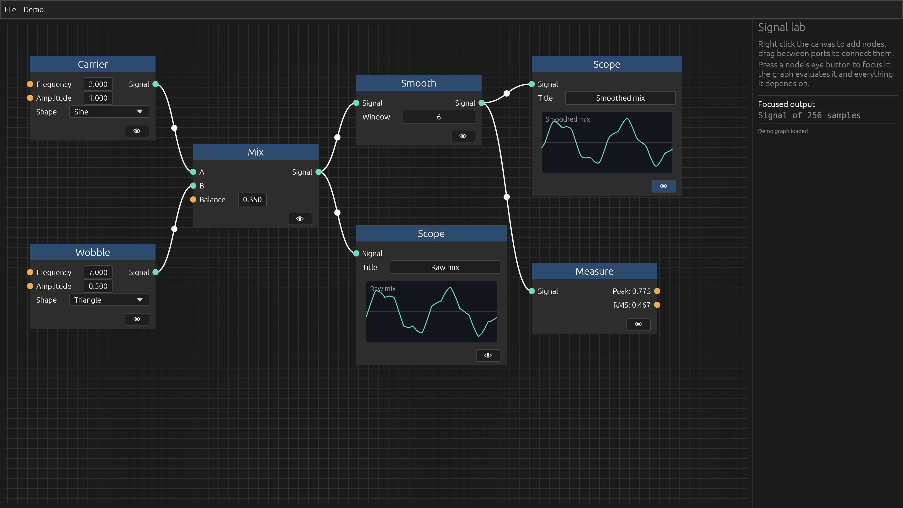
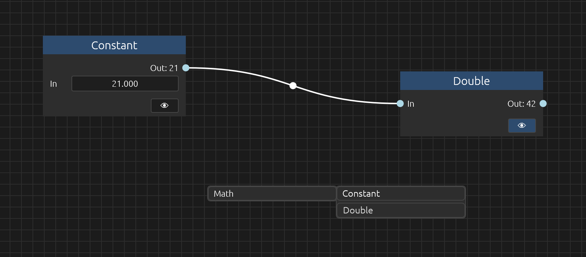
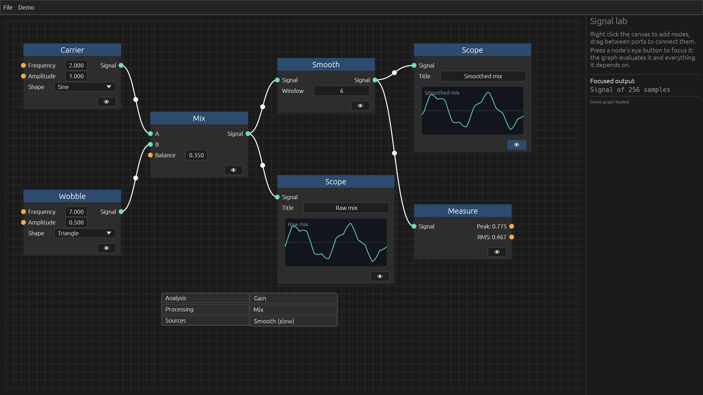
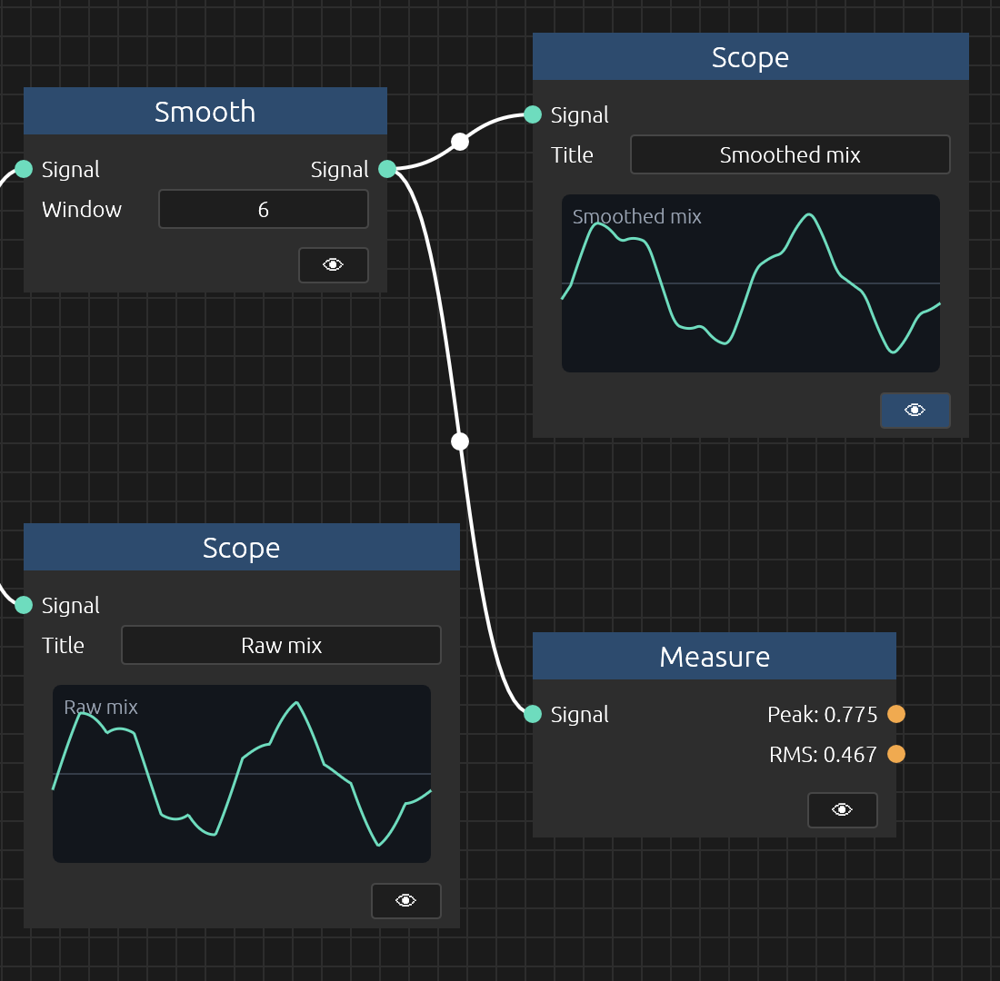

# Knobs – A comprehensive node UI framework

Knobs is a UI node framework based on [egui](https://crates.io/crates/egui) with visualization, evaluation, and result
presentation rolled into a coherent single solution.

Knobs aims to be an all-in-one library that gets you to write the least amount of boilerplate in the most expressive way
to create what you need. It is written to provide all the bits and pieces that a semi-complex node interface needs.



---

## Features

- **Widgets** – Feature-rich widget and inputs selection with conditional inputs, inline values, and more
- **Evaluation** – Integrated evaluator running in a separate thread and hidden away from the user
- **Inputs** – You define what type of data you are dealing with, the library draws the appropriate egui widget
- **Expandability** – Does a node need to preview a wave visualizer? An image? A playable sound? There's a custom UI
  feature for that
- **Threading** – Single node evaluations can optionally run in a thread separate from the evaluator thread
- **Lazy loaded** – Each evaluation runs only when it needs to. Clicking a node's focus button will set that node as a
  result provider, call the upstream evaluations as needed, and trigger the callbacks when it's done
- **Canvas** – Zoom, pan however you want. The canvas is infinitely large
- **Save/Load** – Support for save and load of graph files with serde

---

## Quick Start

### Prerequisites

- egui 0.37.0
- anyhow
- serde

### Installation

`cargo add knobs egui@0.37 anyhow serde --features serde/derive`

Describe your nodes as in the [example](#example) below, create a `Graph` and call `editor.show(ui)` inside egui's
update loop. That's all there is: the graph draws itself, handles the user's input and evaluates the nodes in the
background.

For a bigger example, run the one in the [examples](examples) directory with `cargo run --example signal_lab`.

---

## Example

```rust
use std::convert::Infallible;
use std::sync::Arc;

use egui::Color32;
use knobs::graph::GraphEventHandler;
use knobs::options::Options;
use knobs::{
    ComputeState, ConstantInputType, Graph, NodeBlueprintDefinition, PortDefinition,
    PortInputType, PortOutputType, PortTypeInfo, RuntimeState, input_port, output_port,
};
use serde::{Deserialize, Serialize};

#[derive(Debug, Clone, Copy, PartialEq, Eq)]
enum Kind {
    Number,
}

impl PortTypeInfo for Kind {
    fn color(&self) -> Color32 {
        Color32::LIGHT_BLUE
    }
}

#[derive(Debug, Clone, PartialEq)]
struct Value(f32);

impl TryFrom<&Value> for String {
    type Error = Infallible;

    fn try_from(Value(value): &Value) -> Result<Self, Self::Error> {
        Ok(value.to_string())
    }
}

impl From<&ConstantInputType> for Value {
    fn from(constant: &ConstantInputType) -> Self {
        match constant {
            ConstantInputType::Float { value, .. } => Value(*value),
            _ => Value(0.0),
        }
    }
}

#[derive(Debug, Clone, Copy, PartialEq, Eq, Serialize, Deserialize)]
enum Blueprint {
    Constant,
    Double,
}

impl NodeBlueprintDefinition<Kind, Value> for Blueprint {
    fn all() -> &'static [Self] {
        &[Blueprint::Constant, Blueprint::Double]
    }

    fn name(&self) -> &'static str {
        match self {
            Blueprint::Constant => "Constant",
            Blueprint::Double => "Double",
        }
    }

    fn ports(&self) -> Vec<PortDefinition<Kind, Value>> {
        let input = match self {
            Blueprint::Constant => PortInputType::constant_only(ConstantInputType::default_float()),
            Blueprint::Double => PortInputType::connection_only(),
        };

        vec![
            input_port("in", "In", Kind::Number, input, true),
            output_port(
                "out",
                "Out",
                Kind::Number,
                PortOutputType::ConnectionAndConstant { text_value: None },
                true,
            ),
        ]
    }

    fn categories(&self) -> Vec<&'static str> {
        vec!["Math"]
    }

    fn compute(&mut self, state: &mut RuntimeState<Value>) -> anyhow::Result<ComputeState<Value>> {
        let Value(input) = state.inputs_map.get("in")?;
        let output = match self {
            Blueprint::Constant => *input,
            Blueprint::Double => input * 2.0,
        };

        Ok(ComputeState::done(vec![("out".to_string(), Arc::new(Value(output)))]))
    }

    fn port_for_viewer(&self) -> Option<String> {
        Some("out".to_string())
    }
}

struct PrintFocusedValue;

impl GraphEventHandler<Value> for PrintFocusedValue {
    fn on_focused_output_change(&self, data: Option<Arc<Value>>) -> anyhow::Result<()> {
        println!("Focused node now shows {data:?}");
        Ok(())
    }
}

type Editor = Graph<Kind, Value, Blueprint, PrintFocusedValue>;

fn create_editor() -> Editor {
    Graph::new(Options::default(), PrintFocusedValue)
}

fn draw_editor(ui: &mut egui::Ui, editor: &mut Editor) {
    editor.show(ui);
}
```

To open it in a window, add [eframe](https://crates.io/crates/eframe) (`cargo add eframe@0.37`) and hand the editor to
an app:

```rust
struct App {
    editor: Editor,
}

impl eframe::App for App {
    fn ui(&mut self, ui: &mut egui::Ui, _frame: &mut eframe::Frame) {
        egui::CentralPanel::default().show(ui, |ui| draw_editor(ui, &mut self.editor));
    }
}

fn main() -> eframe::Result {
    eframe::run_native(
        "knobs",
        eframe::NativeOptions::default(),
        Box::new(|_| Ok(Box::new(App { editor: create_editor() }))),
    )
}
```

Right-click the canvas to add nodes, connect them, and press a node's eye button to evaluate it:



---

## Screenshots

 

---

## License

This project is licensed under the Apache 2.0 License — see the LICENSE file for details.